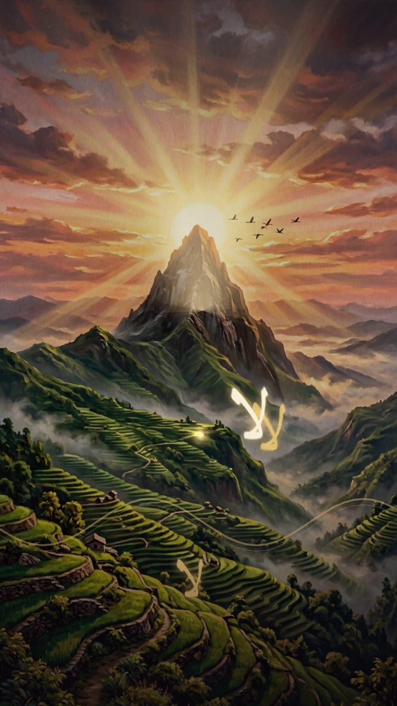

# صباحٌ يُغنَّى — نزار القدسي (موشن جرافيك موسيقي عمودي)

فيلم موشن جرافيك سينمائي عمودي 9:16 من كلمات الشاعر الأنيق **نزار القدسي** —
الفجر يُبنَى غناءً: من ليلٍ نَيلي إلى شمسٍ مبتسمة.

> ملاحظة: تأكد من امتلاك الحقوق اللازمة لأي فيديو أو صوت قبل إعادة نشره أو استخدامه تجاريًا.

## 🎬 العينة (0–62 ثانية) — جاهزة للاعتماد

المقدمة + اسم الشاعر + بناء العالم + اللالا + أول بيت — بالأسلوب النهائي «سينما الشروق».

| الملف | التحميل | الحجم |
|---|---|---|
| العينة 1080p | [تنزيل مباشر](https://raw.githubusercontent.com/zoih6/Nezarmotion/main/deliverables/sample_1080p.mp4) | 28.1 MB |
| العينة 720p (خفيفة) | [تنزيل مباشر](https://raw.githubusercontent.com/zoih6/Nezarmotion/main/deliverables/sample_720p.mp4) | 12.9 MB |
| البوستر | [تنزيل مباشر](https://raw.githubusercontent.com/zoih6/Nezarmotion/main/deliverables/sample_poster.jpg) | 195 KB |
| شيت المشاهد | [تنزيل مباشر](https://raw.githubusercontent.com/zoih6/Nezarmotion/main/deliverables/sample_contact.jpg) | — |
| تقرير الفحص | [تنزيل مباشر](https://raw.githubusercontent.com/zoih6/Nezarmotion/main/deliverables/sample_report.json) | — |

**فحص العينة:** 1860 إطار · 62.00 ثانية · −14.9 LUFS · قمة −3.3 · فك ترميز نظيف ·
تزامن اللالا (42.6) وأول بيت (59.9) ± إطار · ٣ جولات مراجعة.

## 📁 المحتويات

- `deliverables/` — المخرجات الجاهزة للتحميل.
- `production/` — كود الفيلم الكامل + الأصول + الوثائق (البريف، المعالجة، الأسلوب، التوقيتات).
- `الأغنية.mp3` — الأغنية الأصلية (الساعة الرئيسية).
- `file_0000000087fc82088316216847d9bff7.png` — شعار ومض (للخاتمة).
- مقاطع `mp4` — مراجع الأسلوب (القواعد فقط، دون نسخ).

## 🗺️ الطريق إلى الفيلم الكامل (120 ثانية)

1. اعتماد العينة وملاحظاتك عليها.
2. دفعة الأصول الثانية (الغزال، الزهور، الغصون…).
3. مشاهد الأبيات 02–12 + الخاتمة (شعار ومض متحرك).
4. الرندر الكامل + المكس النهائي + الرفع هنا.
