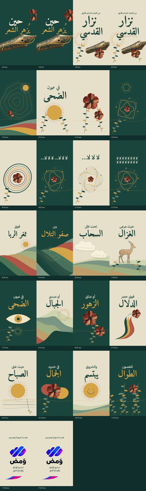

# Nezarmotion

مستودع عام يضم ملفات الحركة والفيديو.

## المحتويات

- مقاطع فيديو مرجعية وتجريبية.
- ملف صوتي وصورة.

> ملاحظة: تأكد من امتلاك الحقوق اللازمة لأي فيديو أو صوت قبل إعادة نشره أو استخدامه تجاريًا.

## 🎬 الفيلم المنجز — القصيدة التي تصير صباحًا

موشن جرافيك موسيقي عمودي من كلمات الشاعر الأنيق **نزار القدسي**، مع تصميم وهندسة صوتية وخاتمة هوية **ومض — استديو الإنتاج والإبداع الفني**.

- المدة: **دقيقتان بالضبط** · 30fps · MP4 متوافق مع الهواتف.
- نسخة النشر: **1080×1920**.
- نسخة خفيفة: **720×1280** مع الصوت نفسه.
- الكلمات تظهر حسب التوقيت المرفق، والشعار الأصلي محفوظ.

| الملف | التحميل | الحجم |
|---|---|---|
| فيديو خفيف 720p | [تنزيل مباشر](https://raw.githubusercontent.com/zoih6/Nezarmotion/main/deliverables/nezar-poetic-motion-light.mp4) | 10.79 MB |
| الفيديو الكامل 1080p | [تنزيل مباشر](https://raw.githubusercontent.com/zoih6/Nezarmotion/main/deliverables/nezar-poetic-motion.mp4) | 28.86 MB |
| بوستر | [تنزيل مباشر](https://raw.githubusercontent.com/zoih6/Nezarmotion/main/deliverables/poster.jpg) | 212 KB |
| إطارات من جميع المشاهد | [تنزيل مباشر](https://raw.githubusercontent.com/zoih6/Nezarmotion/main/deliverables/contact-sheet.jpg) | 446 KB |
| توقيت الكلمات | [تنزيل مباشر](https://raw.githubusercontent.com/zoih6/Nezarmotion/main/deliverables/lyrics.srt) | 1 KB |
| تقرير التسليم | [تنزيل مباشر](https://raw.githubusercontent.com/zoih6/Nezarmotion/main/deliverables/delivery-report.json) | 2 KB |

### بوستر الفيلم

### معاينة المشاهد

### المصدر البرمجي

المشروع الكامل في [`production/`](production/README.md): كود Canvas، الأصول، الخطوط، مخطط الإنتاج، التصيير، والمراجعات.

**قياسات الصوت:** −14.07 LUFS، و−2.41 dBTP. **فحص الملف:** 3600 إطار، 120.000 ثانية، دون أخطاء فك ترميز.

توجد كلمات الأغنية داخل الفيديو بالفعل؛ ملف SRT مرجع زمني اختياري. لا توجد لقطات مقتبسة من المقاطع المرجعية ولا صورة مولدة تمثل الشاعر.
